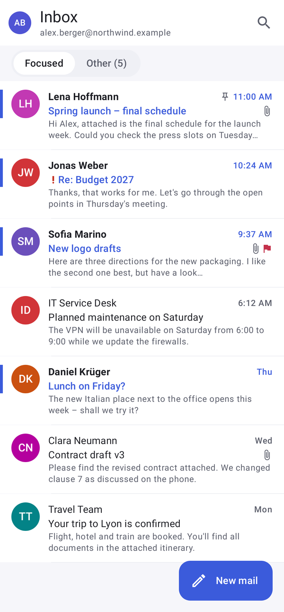
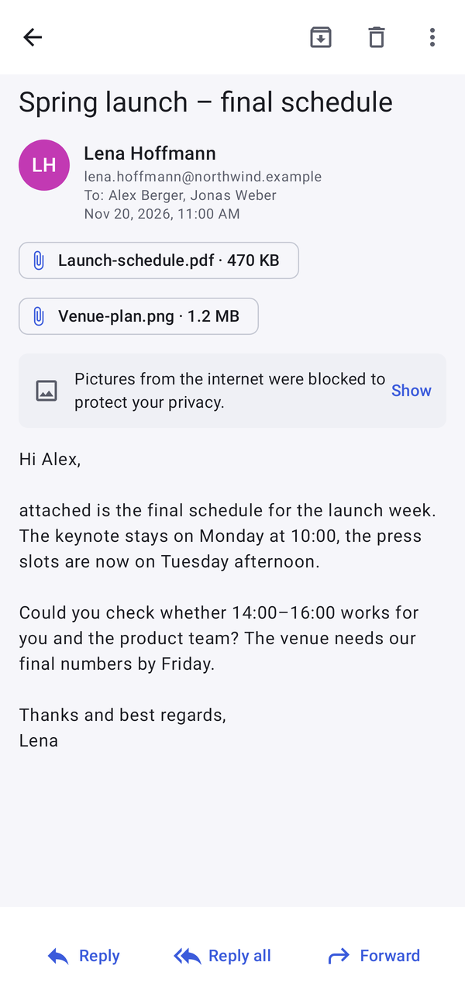
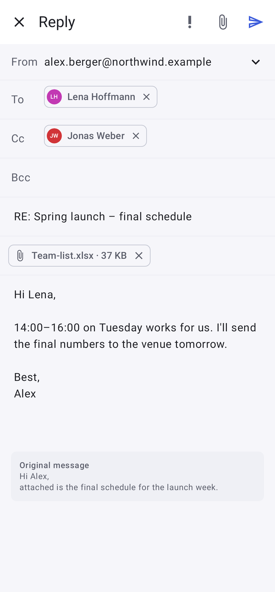
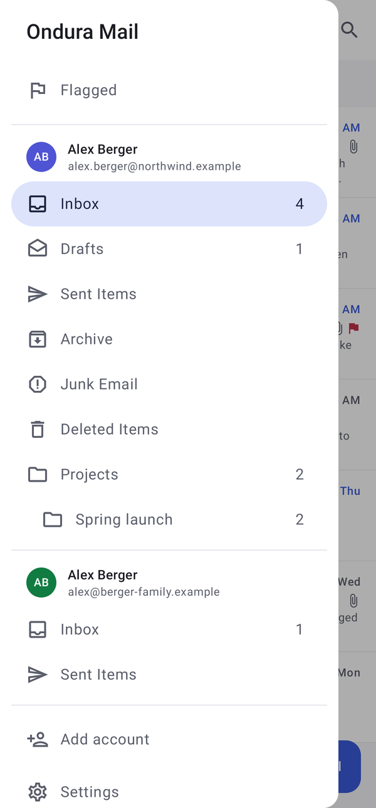
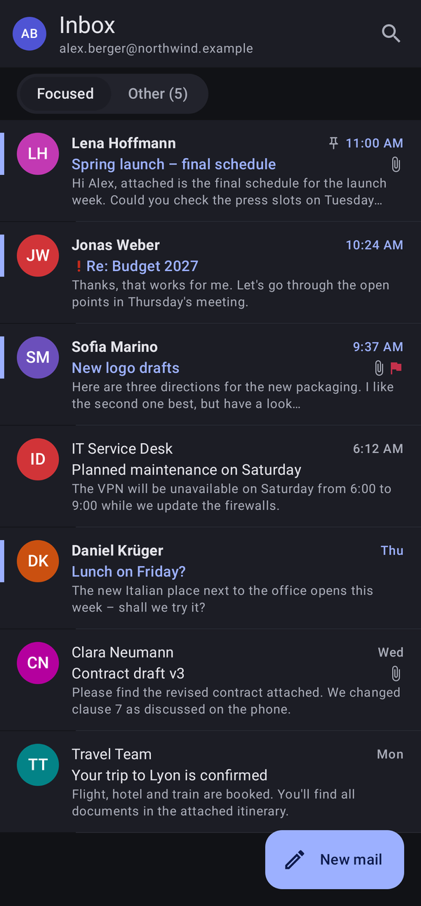
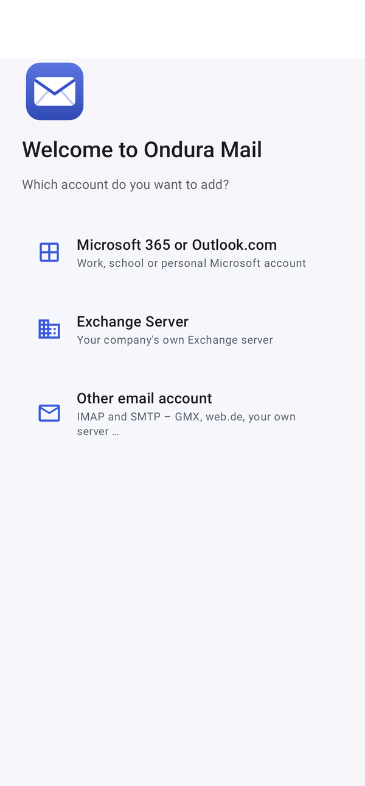

  

<h1 align="center">Ondura for Android</h1>

  

<b>Ondura Mail</b> – Microsoft 365, Exchange and IMAP in one app, with the same engine as Ondura on the desktop

<a href="https://ondura.mirranet.de">ondura.mirranet.de</a>

  &nbsp;
  &nbsp;
  

Ondura Mail on the phone is not a separate product with its own quirks: the
mail engine, the local store and the connections to Microsoft 365, Exchange
and IMAP are literally the same code the desktop app runs
([Ondura-Core](https://github.com/Ondura-Suite/Ondura-Core)). The app around it
is native Android.

## What it does

- **Microsoft 365 and Outlook.com** – sign in on Microsoft's own page, nothing
  to set up
- **Exchange Server** (on premises) through Exchange Web Services
- **Any IMAP account** – the server settings are found automatically; servers
  with their own certificate can be trusted once
- **Focused Inbox**, flags, pinning, snooze, archive and swipe actions
- **Offline first** – your mail is stored on the phone, changes made offline
  are sent as soon as there is a connection
- **Search** on the phone and, for older mail, on the server
- **Privacy** – pictures from the internet are blocked until you allow them,
  passwords are kept in the Android Keystore and never leave the device
- **Notifications** for new mail, also when the app is closed
- German, English and French

  &nbsp;
  &nbsp;
  

Calendar, contacts and tasks are next – inside Ondura Mail, like on the
desktop.

## Download

Every release comes with an APK on the
[releases page](https://github.com/Ondura-Suite/Ondura-Android/releases).
Android 8.0 or newer.

More about Ondura: [ondura.mirranet.de](https://ondura.mirranet.de)

## Building

See [docs/development.md](docs/development.md).

## Licence

GNU General Public License 3.0 or later, like the rest of Ondura.
